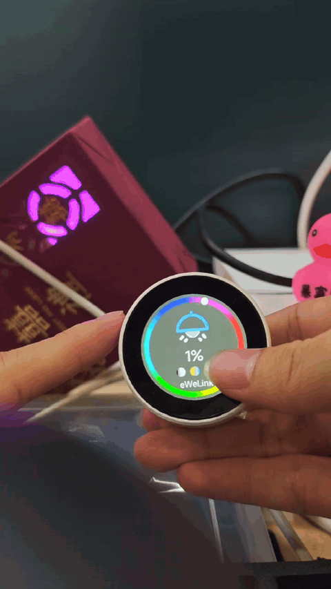

# OpenNextion ESPHome 旋钮控制面板

[English](README.md)

这是 ONX2424G013 圆形旋钮屏的 ESPHome 固件工程。它以 ESP32-S3 为硬件平台，使用 ESP-IDF、LVGL 和项目内置的自定义组件，为 Home Assistant 提供可通过旋钮和按键操作的本地控制面板。

## 演示

<p align="center">
  
</p>

## 功能概览

- 通过 ESPHome API 接入 Home Assistant，在屏幕上控制开关、灯、插座、窗帘和自动化。
- 支持旋钮旋转与按压、屏幕亮度和待机设置，以及待机天气显示。
- 未配置网络时提供热点与 captive portal，供首次 Wi-Fi 配网使用。
- 支持通过 HTTPS 固件清单 OTA 更新；已发布的 OTA 固件和清单位于 `firmware/` 目录。

主要配置入口为 [ONX2424G013.yaml](ONX2424G013.yaml)。硬件配置为 ESP32-S3、16 MB Flash、Octal PSRAM 和 GC9A01A 圆形显示屏；请仅在兼容的 ONX2424G013 硬件上使用。

## v1.1.0 更新内容

相较于 v1.0.1，此版本修复了 Home Assistant 实体较多时“刷新实体列表”卡住或崩溃的问题，并改进了对新版 ESPHome 的兼容性：

- 通过一次 `render_template` WebSocket 订阅获取受支持的实体，收到结果后取消订阅。天气实体排在前面；列表最多 200 项，响应上限为 128 KB。
- 在主循环中解析实体并更新下拉选项，避免大响应阻塞 WebSocket 任务或耗尽内存。
- 按 UTF-8 字符边界截断实体名称，避免无效选项导致 Home Assistant API 反复断开连接。
- 在代码生成阶段自动应用 ESPHome API 大消息分包修复，适用于 PlatformIO 和原生 ESP-IDF 构建。
- 更新 Select 和 IP 地址相关 API 调用，兼容 ESPHome 2026.8 及后续版本。已使用 ESPHome 2026.6.3 和 2026.10.1 验证编译。

## Home Assistant 设置

若要控制实体，请在该设备的 ESPHome 集成选项中启用 **“允许设备执行 Home Assistant 操作”**（设置 → 设备与服务 → ESPHome → 对应的 ONX2424G013 设备 → 配置）。否则，即使屏幕响应了旋钮按压，Home Assistant 仍会拒绝 `light.toggle`、`switch.toggle` 等操作。

### 实体列表

设备不会下载完整的 Home Assistant 实体注册表，而是通过 WebSocket API 发起 `render_template` 请求，只返回旋钮支持的实体：

- `switch`、`light`、`cover` 和 `automation`；`weather` 实体始终优先列出。
- 设备最多保存 200 个实体，超出部分会被截断。模板也通过 `variables.limit` 在 Home Assistant 端限制结果数量。

## 环境要求

本项目支持 **ESPHome 2026.6.3** 及更新版本，包括 2026.8 及后续的原生构建系统；已验证 ESPHome 2026.6.3 和 2026.10.1。推荐使用 Docker，保持 ESPHome、PlatformIO 或 ESP-IDF 版本一致。

- Docker（推荐），或安装了 `esphome==2026.6.3` 的 Python 环境
- 首次编译需联网下载 ESP-IDF/PlatformIO 依赖
- 用于烧录的 USB 数据线（仅充电线无法烧录）

## 克隆仓库并编译

请先克隆完整仓库。此项目的 YAML 依赖仓库内的 `packages`、`my_components`、`assets` 和 `fonts`，不能只下载或复制 `ONX2424G013.yaml` 单独编译。

```bash
git clone https://github.com/OpenNextion/OpenNextion-Example-ESPHome_KNOB_Control.git
cd OpenNextion-Example-ESPHome_KNOB_Control
```

### 使用 Docker（推荐）

Linux/macOS：

```bash
docker run --rm \
  -v "$PWD":/config \
  -w /config \
  ghcr.io/esphome/esphome:2026.6.3 \
  compile ONX2424G013.yaml
```

Windows PowerShell：

```powershell
docker run --rm -v "${PWD}:/config" -w /config ghcr.io/esphome/esphome:2026.6.3 compile ONX2424G013.yaml
```

### 使用本机 ESPHome

```bash
python -m pip install "esphome==2026.6.3"
esphome version
esphome compile ONX2424G013.yaml
```

编译成功后，首次通过浏览器安装所需的工厂固件位于 `.esphome/build/onx2424g013/.pioenvs/onx2424g013/firmware.factory.bin`。后续串口上传使用 ESPHome 构建输出中提示的固件文件即可。

## USB 串口烧录

推荐使用 Docker 编译并烧录本项目。使用 Docker 或 ESPHome Web 烧录时，不需要在本机安装 ESPHome。

### Docker（推荐，Linux）

将实际串口映射到容器。以下命令会在需要时编译项目并上传固件：

```bash
docker run --rm \
  --device=/dev/ttyACM0 \
  -v "$PWD":/config \
  -w /config \
  ghcr.io/esphome/esphome:2026.6.3 \
  run --device /dev/ttyACM0 ONX2424G013.yaml
```

请将 `/dev/ttyACM0` 替换为设备实际串口。若设备没有自动进入下载模式，请在开始上传时按住 `BOOT`（GPIO0）键，短按 `RESET`（如果硬件提供），然后松开 `BOOT`。上传完成后重启设备。

### 本机 ESPHome CLI

如果已按前文安装 `esphome==2026.6.3`，连接设备后执行以下命令。该命令会在需要时编译固件并上传；提示选择串口时，选择设备对应的端口，例如 Linux 的 `/dev/ttyACM0` 或 `/dev/ttyUSB0`、Windows 的 `COM3`：

```bash
esphome run ONX2424G013.yaml
```

也可以明确指定端口：

```bash
esphome run --device /dev/ttyACM0 ONX2424G013.yaml
```

## 浏览器安装（首次烧录）

也可在 Chrome 或 Edge 中打开 [ESPHome Web](https://web.esphome.io/)，连接 USB 设备后选择工厂固件文件安装。此方式需要支持 Web Serial 的 Chromium 浏览器，但不需要在本机安装 ESPHome。

- **从源码编译：** 编译仓库后，选择 `.esphome/build/onx2424g013/.pioenvs/onx2424g013/firmware.factory.bin`。
- **不在本地编译：** 从 [v1.1.0 Release](https://github.com/OpenNextion/OpenNextion-Example-ESPHome_KNOB_Control/releases/tag/v1.1.0) 下载工厂固件，并在 ESPHome Web 中选择该文件。

## 使用手册

设备配网、接入 Home Assistant、屏幕操作及 OTA 更新等使用说明，请访问[在线使用手册](https://opennextion.github.io/OpenNextion-Example-ESPHome_KNOB_Control/)。

## 项目结构

- `ONX2424G013.yaml`：项目主配置和编译参数。
- `packages/`：设备、联网、显示、输入和正常模式的拆分配置。
- `my_components/`：项目专用 ESPHome 外部组件。
- `assets/`、`fonts/`：界面图标、天气图标和 MiSans 字体。
- `docs/`：README 使用的演示素材。
- `firmware/`：发布用 OTA 二进制文件及清单。
- `User Manual/`：随项目提供的网页使用说明。

## 常见问题

- **找不到串口：** 更换 USB 数据线，确认系统已识别串口，并关闭占用该串口的程序。
- **编译时找不到资源或组件：** 确认是在克隆仓库后的根目录执行命令，且没有遗漏项目目录。
